<div align="center">

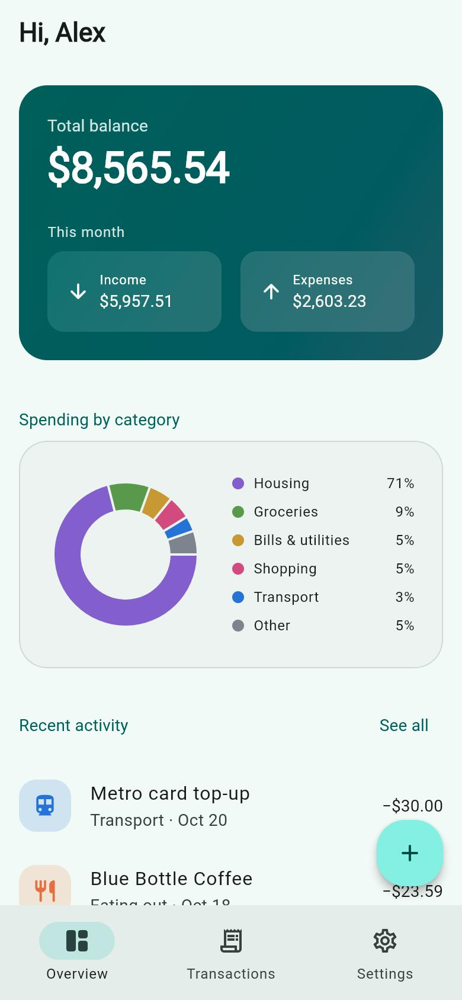

# Pennypath

**An offline-first personal finance app built with Flutter.**

Clean architecture · swappable backend · offline sync · encrypted storage · biometric lock · 3 languages · light & dark themes · 78 automated tests


</div>

Pennypath tracks income and expenses across devices and keeps working without a connection.
It is built as a reference implementation of a production Flutter app: layered architecture, a
backend that can be swapped by configuration, offline-first sync, and security suited to financial
data, all covered by automated tests.

---

## Contents

- [Highlights](#highlights)
- [Screenshots](#screenshots)
- [Try it](#try-it)
- [Features](#features)
- [Architecture](#architecture)
- [Switching the backend (REST, Firebase, …)](#switching-the-backend-rest-firebase-)
- [Offline-first sync](#offline-first-sync)
- [Security](#security)
- [Localization and theming](#localization-and-theming)
- [Testing and quality](#testing-and-quality)
- [Tech stack](#tech-stack)
- [Project structure](#project-structure)
- [Running and building](#running-and-building)
- [REST API contract](#rest-api-contract)
- [Frequently asked questions](#frequently-asked-questions)
- [Production notes](#production-notes)

---

## Highlights

| Area | Details |
|---|---|
| **Offline-first** | Every screen reads from an encrypted on-device database. Changes made offline are queued and synced automatically when the connection returns. |
| **Swappable backend** | The UI never talks to a server directly. Moving between a mock server, a REST API, Firebase or Supabase is a configuration change plus one data class per feature. |
| **Security** | Tokens in the iOS Keychain / Android Keystore, AES-256 encrypted local data, optional Face ID / fingerprint lock, data wiped on sign-out. [Details](#security). |
| **Maintainable code** | Clean architecture, feature folders, shared UI components, strict lint rules, no code generation. |
| **Tested** | 76 unit and widget tests plus 2 on-device integration tests, 84% coverage, enforced in CI. |
| **International** | English, Spanish and German, locale-aware money and date formats, 4 currencies, light and dark themes. |
| **Responsive** | iOS, Android and web from one codebase. Bottom navigation on phones, navigation rail on tablets and desktop. |

---

## Screenshots

> Captured from the running app. It can also be [tried in a browser](#try-it) with no install.

| Sign in | Overview | Overview (dark) |
|:---:|:---:|:---:|
| 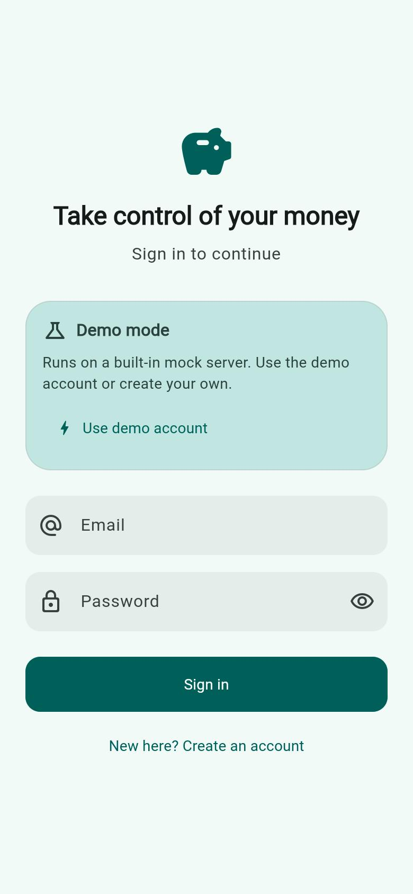 |  | 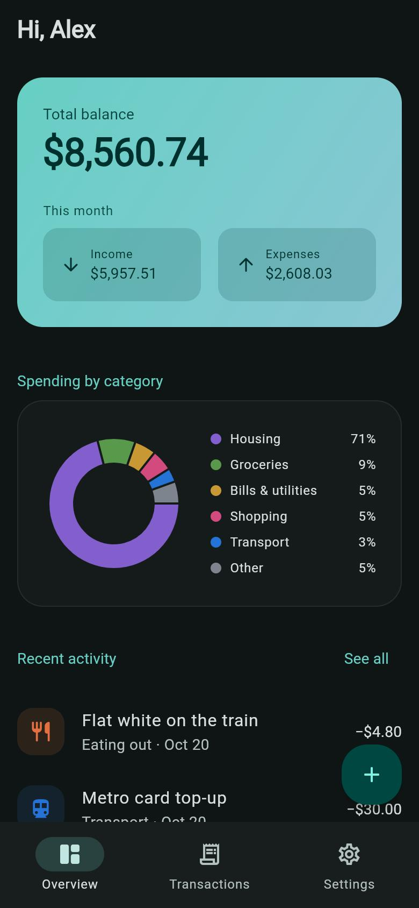 |
| Demo mode signs in with one tap | Balance, monthly totals, spending by category | Fully designed dark theme |

| Transactions | Add transaction | Working offline |
|:---:|:---:|:---:|
| 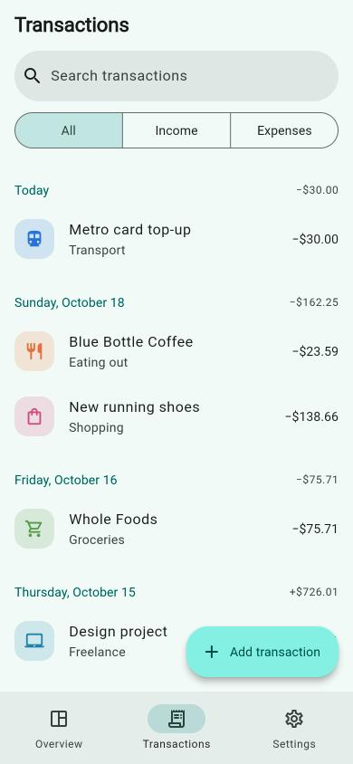 | 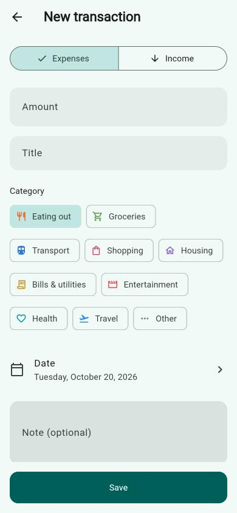 | 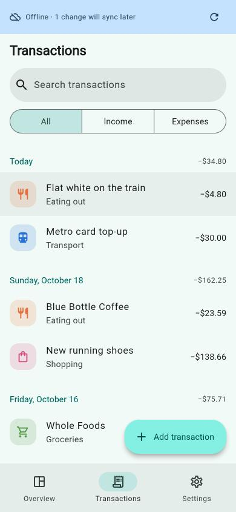 |
| Grouped by day, search, filters, swipe to delete with undo | Validated form, locale-aware amount input | Saved offline, synced automatically later |

| Settings | Language picker | German + euro |
|:---:|:---:|:---:|
| 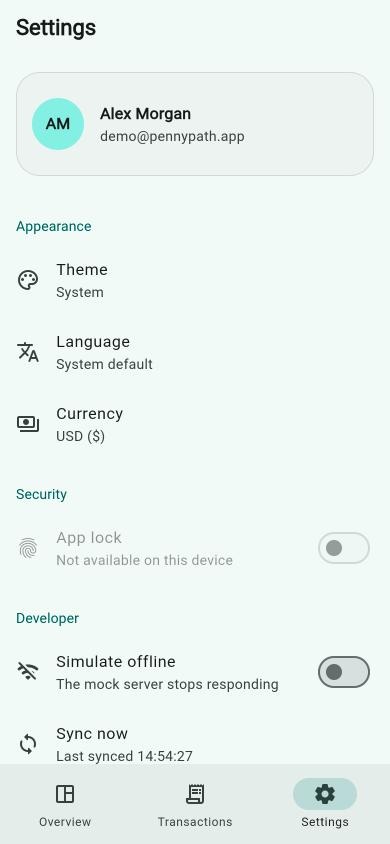 | 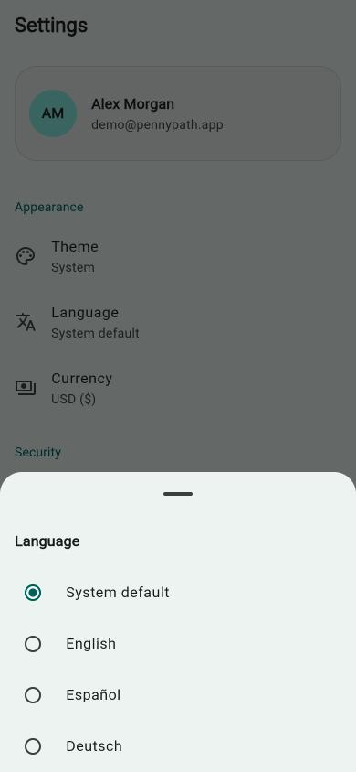 | 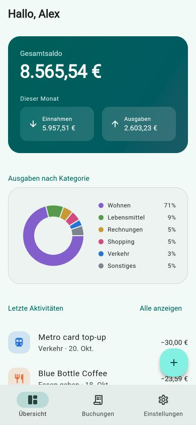 |
| Theme, language, currency, app lock | Switch instantly, no restart | Translations *and* number formats change |

**Tablet / desktop (Spanish):** the layout adapts with a navigation rail and a readable content width.

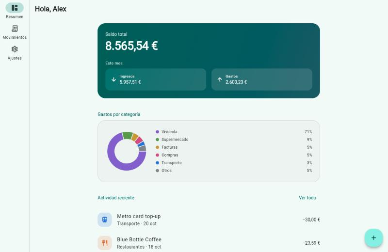

---

## Try it

### In your browser (no install)

**Live demo:** _add your GitHub Pages link here after the first deploy_ (see [Deploying the web demo](#deploying-the-web-demo)).

Tap **Use demo account** on the sign-in screen, or sign in with:

| Email | Password |
|---|---|
| `demo@pennypath.app` | `Demo1234` |

The demo runs on a **built-in mock server**, so there is no backend to set up and nothing is sent anywhere.
The demo account comes with three months of realistic transactions.

**Things to try:**
1. Add an expense, then swipe it left to delete it, then tap **Undo**.
2. Go to **Settings → Developer → Simulate offline**, add a transaction, and watch the offline banner. Turn it off and tap retry: the change syncs.
3. Switch language to **Deutsch** or **Español** and currency to **EUR**: amounts reformat (`8.565,54 €`).
4. Switch theme to **Dark**.
5. Make the browser window wide: the layout switches to tablet mode.

### On Android

Download the APK from the repository's **Releases** page and install it (demo mode, no setup).

### From source

See [Running and building](#running-and-building). App lock (Face ID / fingerprint) is available on devices and simulators, not on web.

---

## Features

**For the user**
- Sign in / create account, with the session kept securely between launches
- Overview: total balance, this month's income and expenses, spending donut chart, recent activity
- Transactions: grouped by day with daily totals, debounced search, income/expense filter, pull to refresh
- Add and edit transactions, with category chips, date picker, notes and validation
- Swipe to delete with **undo**
- Settings: theme (system/light/dark), language (system/EN/ES/DE), currency (USD/EUR/GBP/INR), app lock
- Biometric / device-PIN app lock that re-locks after 30 seconds in the background
- Balances are blurred in the app switcher when app lock is on
- Offline banner showing how many changes are waiting to sync

**Under the hood**
- Clean architecture with feature-first folders
- Backend selected by configuration (`mock` or `rest`), ready for Firebase/Supabase
- Offline-first sync engine with a change queue and conflict handling
- Encrypted local database, secure token storage, token refresh, certificate pinning
- Logging, crash reporting and analytics behind interfaces
- Shared, reusable UI components and a single design-token theme
- 78 automated tests, GitHub Actions CI with a coverage gate, web demo and APK releases
- Branded app icon and native splash screen on every platform

---

## Architecture

### Layers

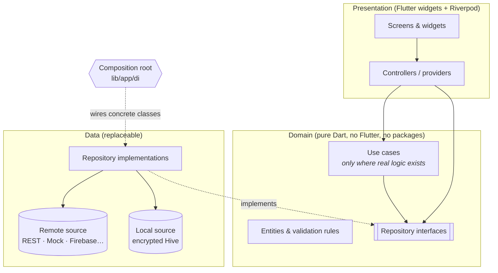

**The dependency rule:** arrows only point inward. Screens know about use cases and repository
*interfaces*, never about Dio, Hive, Firebase or JSON. The only place that knows which concrete
classes are used is the composition root in [`lib/app/di/`](lib/app/di).

### Use cases only when they earn their place

A use case that only forwards a call to a repository is boilerplate, so this project creates one
only when there is real logic:

| Use case | Why it exists |
|---|---|
| `SaveTransaction` | Validates every field, normalises input, assigns ids and timestamps, logs analytics |
| `FilterTransactions` | Search, type filter, sorting and grouping by day |
| `ComputeDashboardSummary` | Balance, monthly totals, category ranking, merging small categories into "Other" |
| `SignOut` | Uploads pending changes (with a timeout), ends the session, wipes every user data store |

Sign in and sign up have no use case: the controller calls `AuthRepository` directly, because a
use case there would only pass the call through.

### Example: what happens when you add a transaction

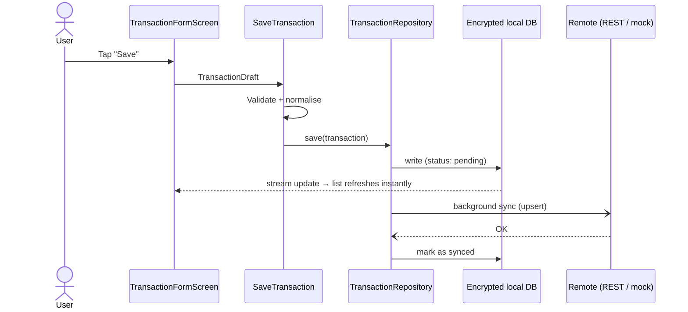

### DRY by design
- **One source of validation:** `TransactionRules` and `AuthRules` are used by both the forms and the use cases. Error codes become text in one place ([`l10n_mappers.dart`](lib/core/l10n/l10n_mappers.dart)).
- **Shared UI building blocks** in [`lib/core/widgets`](lib/core/widgets): `AppButton` (with a loading state), `AppTextField` (with a password toggle), `AsyncValueView` (loading/error/data), `StatusView` (empty/error states), `SectionHeader`, `showChoiceSheet<T>` (reused for theme, language and currency), `showConfirmDialog`, `ResponsiveBody`.
- **One theme definition** builds both light and dark themes from the same design tokens ([`app_theme.dart`](lib/core/theme/app_theme.dart)).
- **One error pipeline:** data sources throw typed exceptions, `guard()` turns them into `Failure`s, and the UI shows one localized message per failure type.

---

## Switching the backend (REST, Firebase, …)

The backend is chosen at build time:

```bash
# Built-in mock server (default)
flutter run --dart-define-from-file=config/mock.json

# Real REST API
cp config/rest.example.json config/rest.json   # then edit the URL
flutter run --dart-define-from-file=config/rest.json
```

Each feature depends on a small interface, for example:

```dart
abstract interface class TransactionRemoteDataSource {
  Future<List<TransactionDto>> fetchAll();
  Future<void> upsert(TransactionDto transaction);
  Future<void> delete(String id);
}
```

### Adding Firebase (or Supabase, GraphQL, …)

1. Add `firebase` to `BackendMode` in [`app_config.dart`](lib/core/config/app_config.dart).
2. Implement the interfaces, e.g. `TransactionFirestoreDataSource implements TransactionRemoteDataSource` and `AuthFirebaseDataSource implements AuthRemoteDataSource`.
3. Add one `switch` case in [`transactions_providers.dart`](lib/app/di/transactions_providers.dart) and [`auth_providers.dart`](lib/app/di/auth_providers.dart):

```dart
BackendMode.firebase => TransactionFirestoreDataSource(FirebaseFirestore.instance),
```

| Changes | Does **not** change |
|---|---|
| 1 enum value, 1 data source class per feature, 1 line per provider | Screens, widgets, controllers, use cases, entities, validation, offline sync, tests for the domain |

The local database is swappable the same way: repositories depend on a `LocalDatabase` interface,
and Hive is just the current implementation. Logging, crash reporting (Sentry/Crashlytics),
analytics and biometrics are also interfaces with one line of wiring each.

---

## Offline-first sync

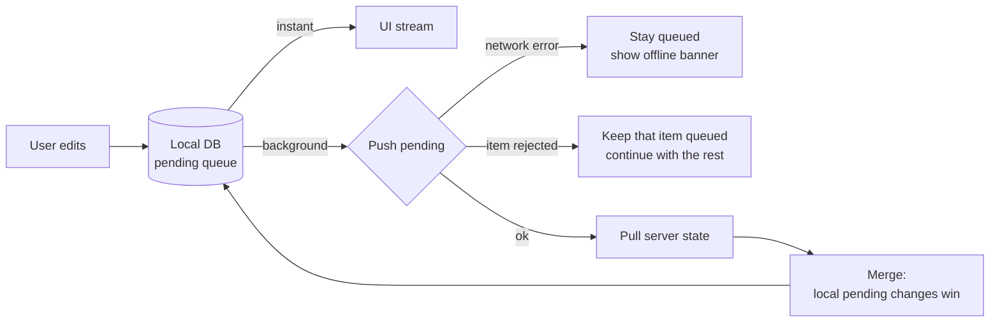

- **Reads always come from the device**, so the app opens and works with no connection.
- **Writes are applied locally first** and marked `pending`. Deletes are hidden immediately and removed after the server confirms.
- **Sync** runs on launch, after every change, on pull-to-refresh and from the retry button. Only one sync runs at a time.
- **Idempotent API calls:** ids are UUIDs generated on the client and updates use `PUT`, so retries never create duplicates.
- **Conflict policy:** unsynced local edits are never overwritten by a pull. An edit made *while* an upload is in flight is detected by timestamp and stays queued.
- **Resilience:** a single rejected record cannot block the rest of the queue. Network and auth errors stop the sync cleanly.
- **Try it:** Settings → Developer → *Simulate offline*.

---

## Security

| Measure | Where |
|---|---|
| Auth tokens stored in iOS Keychain / Android Keystore (`first_unlock_this_device`, never in plain preferences) | [`secure_store.dart`](lib/core/storage/secure_store.dart) |
| Local database encrypted with AES-256; the key is generated with a secure RNG and kept in the Keychain/Keystore | [`hive_local_database.dart`](lib/core/storage/hive_local_database.dart) |
| Biometric / device-PIN app lock, re-locks after 30 s in the background | [`app_lock_controller.dart`](lib/features/app_lock/presentation/controllers/app_lock_controller.dart) |
| Content blurred in the app switcher when app lock is on | [`app_lock_guard.dart`](lib/features/app_lock/presentation/widgets/app_lock_guard.dart) |
| Automatic token refresh: a single refresh for many parallel requests, then sign-out if refresh fails | [`auth_interceptor.dart`](lib/core/network/auth_interceptor.dart) |
| Optional certificate pinning (SHA-256 certificate fingerprints via `CERT_PINS`) | [`certificate_pinning_io.dart`](lib/core/network/certificate_pinning_io.dart) |
| HTTPS required by config validation; Android cleartext traffic disabled (debug allows only `localhost`/emulator) | [`app_config.dart`](lib/core/config/app_config.dart), `android/app/src/main/res/xml` |
| Android backups and device transfer of app data disabled | `AndroidManifest.xml`, `data_extraction_rules.xml` |
| Sign-out uploads pending changes, then wipes tokens and the local database | [`sign_out.dart`](lib/features/auth/domain/usecases/sign_out.dart) |
| No secrets in the repo: config via `--dart-define-from-file`, real configs are git-ignored | `config/`, `.gitignore` |
| Logs only in debug builds; HTTP logs never include headers or bodies; analytics never receive personal data | [`app_logger.dart`](lib/core/services/app_logger.dart), [`dio_factory.dart`](lib/core/network/dio_factory.dart) |
| Input validated in the domain layer, not only in the UI | [`transaction_rules.dart`](lib/features/transactions/domain/transaction_rules.dart) |
| Amounts stored as integer cents (no floating-point rounding errors) | [`transaction.dart`](lib/features/transactions/domain/entities/transaction.dart) |
| Unknown values from a newer API fall back safely instead of crashing | [`transaction_dto.dart`](lib/features/transactions/data/models/transaction_dto.dart) |
| Release builds obfuscated (`--obfuscate --split-debug-info`) | [Building for release](#building-for-release) |
| Even the mock server stores only salted, iterated password hashes | [`auth_mock_data_source.dart`](lib/features/auth/data/datasources/auth_mock_data_source.dart) |

---

## Localization and theming

- **Languages:** English, Spanish and German via ARB files ([`lib/core/l10n/arb`](lib/core/l10n/arb)), with plurals and placeholders. "System default" follows the device language.
- **Formats:** money and dates follow the active locale (`$1,234.56` / `1.234,56 €`). The amount field accepts both `.` and `,` as the decimal separator.
- **Adding a language:** copy `app_en.arb` to `app_fr.arb`, translate it, and add `'fr'` to `AppSettings.supportedLanguages`. No code changes.
- **Theming:** light and dark themes are built from one seed colour and shared design tokens (spacing, radius, semantic finance colours via a `ThemeExtension`). Rebranding means changing a handful of values in [`app_theme.dart`](lib/core/theme/app_theme.dart) and [`finance_colors.dart`](lib/core/theme/finance_colors.dart).
- **Accessibility:** semantic labels on charts and amounts, header semantics on sections, live-region offline banner, tooltips on icon buttons, 48 px+ touch targets, text scaling respected.

---

## Testing and quality

**76 unit and widget tests** run in about 10 seconds, plus **2 integration tests** on a real device or simulator:

| Area | What is verified |
|---|---|
| Domain rules and use cases | Validation, normalisation, filtering and grouping, dashboard maths, sign-out ordering and timeouts |
| Offline sync engine | Instant local writes, offline queueing, recovery when back online, pull merging, deletes, rejected items not blocking the queue |
| Auth and security | Session storage, token refresh (including concurrent 401s), session expiry, password hashing in the mock server |
| Networking | `Dio` error mapping, HTTPS config validation |
| Navigation | All redirect rules (splash, auth, lock, deep links) |
| App lock | Lock on launch, failed authentication, 30 s grace period |
| Full user journeys (widget tests) | Demo sign-in, add → search → swipe-delete → undo, offline add then sync, switching to German, sign-out wiping data |
| REST data source | Cursor pagination across pages, idempotent deletes, HTTP error mapping |
| On device (`integration_test`) | Real Keychain/Keystore and encrypted database, sign-in and adding a transaction |

```bash
flutter test                       # unit + widget tests
flutter test --coverage            # with coverage (coverage/lcov.info)
flutter test integration_test      # on a connected device or simulator
flutter analyze                    # strict lints, zero warnings
```

**CI** ([`.github/workflows/ci.yml`](.github/workflows/ci.yml)) runs formatting, analysis (fails on any info), tests, a **minimum 80% coverage** check and a web build on every push and pull request. Tagging a version (`v1.0.0`) runs [`release.yml`](.github/workflows/release.yml), which publishes an obfuscated Android APK to GitHub Releases.

---

## Tech stack

| Concern | Choice | Why |
|---|---|---|
| State management & DI | **Riverpod 3** | Compile-safe, testable, easy overrides for tests and backend switching |
| Navigation | **go_router** | Declarative routes, auth/lock redirects, deep links, stateful bottom-nav branches |
| Networking | **Dio** | Interceptors (auth refresh, logging), certificate pinning hooks |
| Local database | **Hive CE** (encrypted) | Fast, pure Dart, works on mobile *and* web, AES-256 built in |
| Secure storage | **flutter_secure_storage** | Keychain / Keystore |
| Biometrics | **local_auth** | Face ID, Touch ID, fingerprint, device PIN fallback |
| Charts | **fl_chart** | Lightweight, animated, customisable |
| i18n | **flutter_localizations + intl** (gen-l10n) | Official tooling, type-safe generated strings |
| Testing | **flutter_test + mocktail** | No code generation needed |

No code generation (freezed, json_serializable) is used, deliberately: the project builds with
plain `flutter run`, and models stay short and readable.

---

## Project structure

```
lib/
├── main.dart                     # entry point → bootstrap()
├── bootstrap.dart                # init storage, error handlers, ProviderScope
├── app/
│   ├── app.dart                  # MaterialApp: theme, locale, router
│   ├── di/                       # ★ composition root: the ONLY place that picks implementations
│   ├── router/                   # routes + pure, unit-tested redirect rules
│   ├── providers/                # app-wide formatting providers
│   └── widgets/                  # shell (bottom nav / rail), splash, AmountText
├── core/                         # feature-agnostic building blocks
│   ├── config/                   # AppConfig (backend, URL, pins) from --dart-define
│   ├── error/                    # exceptions → failures, Result type, guard()
│   ├── network/                  # ApiClient, auth interceptor, pinning
│   ├── storage/                  # KeyValueStore, SecureStore, LocalDatabase (+ Hive impl)
│   ├── services/                 # logger, crash reporter, analytics, biometrics (interfaces)
│   ├── mock/                     # mock network simulation, demo account
│   ├── theme/                    # tokens, light/dark themes, finance colours
│   ├── l10n/                     # ARB files, generated code, error → message mappers
│   ├── widgets/                  # shared UI components
│   └── utils/                    # money formatting and input
└── features/
    ├── auth/                     # domain · data · presentation
    ├── transactions/             # domain · data (sync engine) · presentation
    ├── dashboard/                # domain (summary) · presentation (charts)
    ├── settings/                 # domain · data · presentation
    └── app_lock/                 # presentation (controller, lock screen, privacy guard)

test/                             # mirrors lib/ + helpers (in-memory fakes, test app harness)
config/                           # mock.json, rest.example.json
docs/screenshots/                 # images used in this README
```

---

## Running and building

**Requirements:** Flutter 3.44+ (Dart 3.12+). Xcode for iOS, Android Studio / SDK for Android.

```bash
git clone <this-repo> && cd <this-repo>
flutter pub get
flutter run                                   # mock backend, any device
flutter run -d chrome                         # web
flutter run --dart-define-from-file=config/rest.json   # real API
```

### Configuration keys

| Key | Values | Default |
|---|---|---|
| `APP_ENV` | free text (`demo`, `staging`, `production`) | `demo` |
| `BACKEND` | `mock` \| `rest` | `mock` |
| `API_BASE_URL` | `https://…` (required for `rest`) | |
| `CERT_PINS` | comma-separated base64 SHA-256 certificate fingerprints | empty (pinning off) |

### Building for release

```bash
flutter build appbundle --release --obfuscate --split-debug-info=build/symbols \
  --dart-define-from-file=config/rest.json
flutter build ipa --release --obfuscate --split-debug-info=build/symbols \
  --dart-define-from-file=config/rest.json
```

### Deploying the web demo

[`.github/workflows/deploy-web.yml`](.github/workflows/deploy-web.yml) publishes the mock-backend
build to **GitHub Pages** on every push to `main`. Enable it once under
*Settings → Pages → Source: GitHub Actions*. The demo will then be live at
`https://<username>.github.io/<repo>/`.

---

## REST API contract

What a backend needs to implement for `BACKEND=rest`:

| Method | Path | Body | Response |
|---|---|---|---|
| `POST` | `/auth/login` | `{email, password}` | `{accessToken, refreshToken, expiresIn, user: {id, name, email}}` |
| `POST` | `/auth/register` | `{name, email, password}` | same as login · `409` if the email exists |
| `POST` | `/auth/refresh` | `{refreshToken}` | same as login · `401` if expired |
| `POST` | `/auth/logout` | `{refreshToken}` | `204` |
| `GET` | `/transactions?limit=200&cursor=…` | | `{items: [Transaction], nextCursor: string \| null}` (the client follows `nextCursor` until it is `null`) |
| `PUT` | `/transactions/{id}` | `Transaction` | `200/204` (create or update, idempotent) |
| `DELETE` | `/transactions/{id}` | | `204` (`404` is treated as success) |

`Transaction` = `{id, type: "income"|"expense", amountMinor: int, title, category, date: ISO-8601, updatedAt: ISO-8601 UTC, note?}`.
All authenticated endpoints expect `Authorization: Bearer <accessToken>`.

---

## Frequently asked questions

<details>
<summary><b>Does it need a backend to run?</b></summary>

No. By default the app runs against a built-in mock server with realistic demo data, so it can be
explored, developed and tested without any API. A real backend is enabled by configuration.
</details>

<details>
<summary><b>Which platforms does it support?</b></summary>

iOS, Android and web from one codebase. The layout adapts from phones (bottom navigation) to
tablets and desktop (navigation rail with a centred content width). The biometric lock is
available on iOS and Android only.
</details>

<details>
<summary><b>How hard is it to move to Firebase, Supabase or another API?</b></summary>

Each feature talks to its backend through a small interface. A new backend means one data class
per feature and one line of wiring; screens, business rules and offline sync are untouched. See
[Switching the backend](#switching-the-backend-rest-firebase-).
</details>

<details>
<summary><b>What happens without an internet connection?</b></summary>

The app keeps working. Data is read from the encrypted local database, new changes are saved
locally and queued, and a banner shows how many changes are waiting. When the connection returns,
everything uploads automatically and without duplicates.
</details>

<details>
<summary><b>How is sensitive data protected?</b></summary>

Tokens are stored in the Keychain/Keystore, local data is encrypted, an optional biometric lock
hides content (including in the app switcher), app-data backups are disabled, HTTPS is enforced
with optional certificate pinning, and all data is wiped on sign-out. See the
[security table](#security) for each measure and where it is implemented.
</details>

<details>
<summary><b>How are errors and crashes handled?</b></summary>

Data sources throw typed exceptions, which are converted into `Failure` values and shown as
translated, user-friendly messages. Uncaught errors go to a `CrashReporter` interface, which logs
in this project and can be connected to Sentry or Firebase Crashlytics with one line of wiring.
</details>

<details>
<summary><b>How do I add a language or change the branding?</b></summary>

Add an ARB file (for example `app_fr.arb`) and register the language code in `AppSettings`.
Flutter mirrors layouts automatically for right-to-left languages. Branding lives in
[`app_theme.dart`](lib/core/theme/app_theme.dart) and
[`finance_colors.dart`](lib/core/theme/finance_colors.dart); light and dark themes follow automatically.
</details>

<details>
<summary><b>Is it accessible?</b></summary>

Screens include screen-reader labels (with a spoken summary of the chart), header semantics,
tooltips on icon buttons, large touch targets, support for system text size, and both light and
dark themes.
</details>

<details>
<summary><b>Why Riverpod?</b></summary>

Compile-time safety, simple dependency injection, and easy overrides. Those overrides power both
the backend switch and the in-memory test setup. The architecture itself does not depend on
Riverpod; the domain layer is plain Dart and would work the same with Bloc.
</details>

<details>
<summary><b>Will the structure scale as features are added?</b></summary>

Each feature is self-contained (`domain`, `data`, `presentation`), so new features sit alongside
existing ones without touching them, and several developers can work in parallel.
</details>

---

## Production notes

Some production concerns are deliberately described here rather than built, to keep the codebase
focused. The architecture already has the extension points for each.

| Topic | Approach |
|---|---|
| **Crash reporting** | Errors already flow through the `CrashReporter` interface. Add `sentry_flutter` or Firebase Crashlytics, implement the two methods, and swap the provider in [`core_providers.dart`](lib/app/di/core_providers.dart). |
| **Build flavors** | Environments are switched with `--dart-define-from-file` (`config/*.json`). For separate dev/staging/prod apps on one phone, add Android `productFlavors` and iOS schemes with a bundle-id suffix, each pointing to its own config file. |
| **Store releases** | Release builds are obfuscated and the APK is built in CI. Signing and uploading to the App Store / Play Store would be added with Fastlane or Codemagic using secrets stored in CI. |
| **Large datasets** | The API is paginated and the list is lazily rendered. For very large accounts, sync would switch to deltas (`updatedSince`) with server-side tombstones for deletes. |
| **Visual regression** | Golden tests would be added for the core widgets and generated on a single CI platform, since font rendering differs between macOS and Linux. |
| **Device testing in CI** | The `integration_test` suite runs locally on any simulator or device. In CI it would run on Firebase Test Lab or an emulator job. |
| **Device integrity** | Jailbreak/root detection and screenshot blocking can be added where the risk profile requires it. |
| **Product features** | Budgets, insights, receipt scanning (OCR), push notifications and a home-screen widget all fit into the existing feature-folder structure. |

---

## License

Copyright © 2026 mobileexpert1. All rights reserved.

The source is shared for viewing and evaluation only. Copying, modifying, redistributing or using
any part of it in other projects is not permitted without written permission. See [LICENSE](LICENSE).
